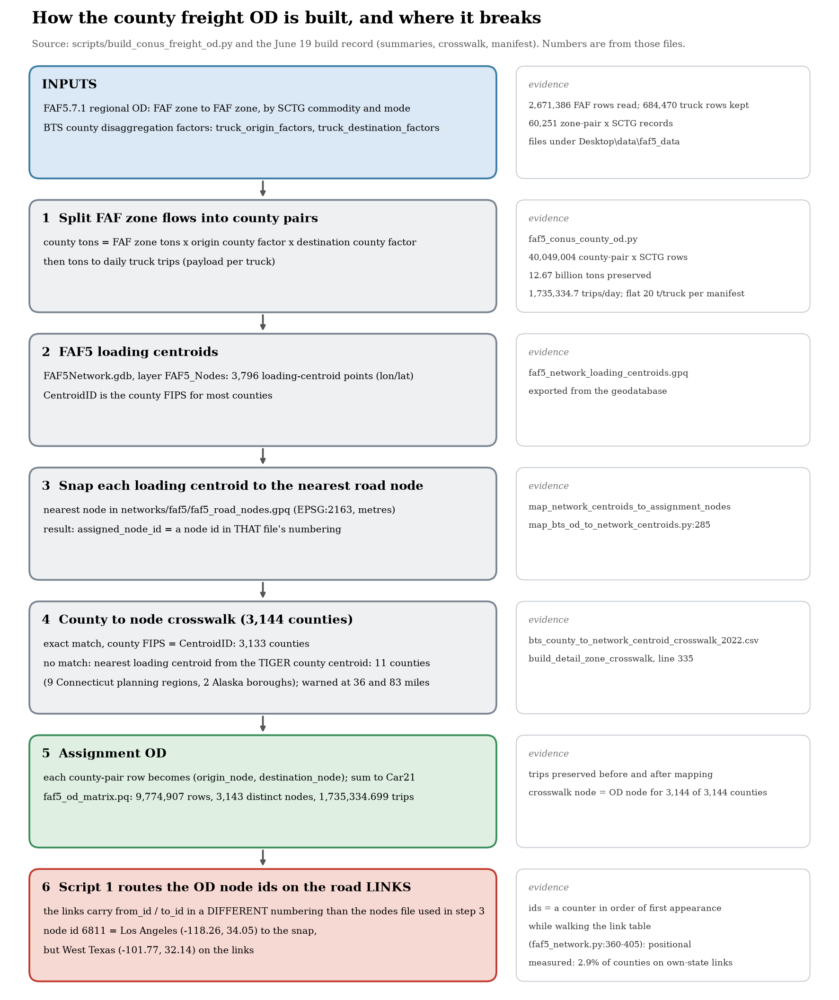

# How the county freight OD is built, step by step (from the code and the June 19 build record)

Written 2026-11-11. Everything below was read from `scripts/build_conus_freight_od.py`, `src/preprocess/map_bts_od_to_network_centroids.py`,
`src/resiflow/preprocess/faf5_network.py`, and the build record in `Desktop\data\faf5_data\processed\` (summaries, crosswalk) and
`Desktop\data\soge_clusters\tables\conus_freight_od_manifest.json`. Where I am inferring, it says so.

## The steps

| # | What happens | Code | Build record (June 19) |
|---|---|---|---|
| In | FAF5.7.1 regional OD (FAF zone to FAF zone by SCTG and mode) plus BTS county disaggregation factors (truck origin and destination) | `faf5_conus_county_od.py` | 2,671,386 FAF rows read, 684,470 kept (truck, year); 60,251 zone-pair x SCTG records |
| 1 | Split each FAF zone flow into county pairs: tons x origin county factor x destination county factor; tons to daily truck trips | `run_conus_county_od_by_sctg` | 40,049,004 county-pair x SCTG rows; 12.67 billion tons preserved; 1,735,334.7 trips/day |
| 2 | FAF5's own network loading centroids: layer `FAF5_Nodes` of `FAF5Network.gdb`, 3,796 points (lon/lat). `CentroidID` is the county FIPS for most counties | `read_network_centroid_table` | `faf5_network_loading_centroids.gpq` |
| 3 | Snap each loading centroid to the nearest road node of `networks/faf5/faf5_road_nodes.gpq` (EPSG:2163). The result is a node id **in that file's numbering** | `map_network_centroids_to_assignment_nodes` (line 285) | |
| 4 | Per county: exact match of county FIPS to `CentroidID` (3,133 counties); otherwise the nearest loading centroid from the TIGER county centroid (11 counties: 9 Connecticut planning regions, 2 Alaska boroughs). Warnings beyond 25 and 50 miles (Chugach 36 mi, Copper River 83 mi) | `build_detail_zone_crosswalk` (line 335) | `bts_county_to_network_centroid_crosswalk_2022.csv` |
| 5 | Replace county ids by node ids and sum: `faf5_od_matrix.pq` (`origin_node`, `destination_node`, `Car21`) | `aggregate_od_to_network_centroids`, `collapse_assignment_od` | 9,774,907 rows; 3,143 distinct nodes; 1,735,334.699 trips; crosswalk node equals OD node for 3,144 of 3,144 counties |
| 6 | Script 1 builds the routing graph from `faf5_road_links.gpq` (`from_id`, `to_id`) and routes the OD node ids on it | `road_revised.network_flow_model` | |

**A note on your description.** The primary path is not "make county centroids from the county map and snap them". It snaps FAF5's own loading
centroids (step 3) and joins counties to them by FIPS (step 4). The TIGER county centroid is only the fallback reference for the 11 counties
with no exact match. The whole-method fallback `map_county_od_via_county_shp` was not used: the build summary says the mapping method was
`faf5_loading_centroids`.

## Where it breaks (verified)

Step 3 produces node ids in the numbering of the nodes file it was given. Step 6 uses node ids in the numbering of the links. These differ.

| Check | Result |
|---|---|
| Node 6811 (Los Angeles County's node) | Los Angeles (-118.262, 34.051) in the snap's nodes file; West Texas (-101.767, 32.140) in the current nodes file |
| Node 168267 (Autauga County, AL) | (-86.452, 32.470) in the snap's file; north-west Arkansas (-94.183, 36.142) in the current file |
| Intended node vs TIGER county centroid | median 7.5 km, p99 63 km (the builder's snap is sensible) |
| Same node id located in the current network vs intended | median 1,396 km; 0% within 25 km |
| Counties whose node touches links of their own state | 2.9% (chance level) |

## Why the ids can differ (mechanism from the code, not yet established as the actual cause)

`extract_node_connectivity` (`faf5_network.py` lines 360-405) gives each link endpoint an integer from a counter that increments in order of first
appearance while walking the link table. Node ids are therefore a property of the row order at conversion time, not stable identifiers. Any
reordering, filtering or re-export changes every id. The nodes file used in step 3 (May 28) and the links the model uses were evidently not
produced from the same ordering. **Not established:** which run produced which file, and why the local May-28 links backup is already in the
links' numbering. Pinning this down needs the original conversion run, which is not in the repo.

## The correction (already merged, `scripts/make_conterminous_od.py`)

Take each OD node's true location from the snap's nodes file and re-snap it to the nearest suitable node of the current network (median
28 m, p99 12 km); drop Alaska and Hawaii. Result: 99.8% of counties on links of their own state, and no flow between disconnected components.
See `OD_NODE_NUMBERING_MISMATCH.md`.

## Review these in QGIS or ArcGIS Pro (`Desktop\gis_review\`)

See `Desktop\gis_review\README.txt` for layer names and a suggested order. Regenerate with `scripts/diagnostics/export_od_review_gpkg.py`.

## Still open

- The original cause of the numbering divergence (see above).
- The manifest records a flat 20 tons per truck, while `FREIGHT_OD_DISAGGREGATION.md` says the default is the T29 table by SCTG group. The OD in
  every run so far used the manifest's 20.0; the difference has not been quantified.
- Whether the corrected OD is what you want as the new baseline: that is for you to confirm after looking at the centroids.
